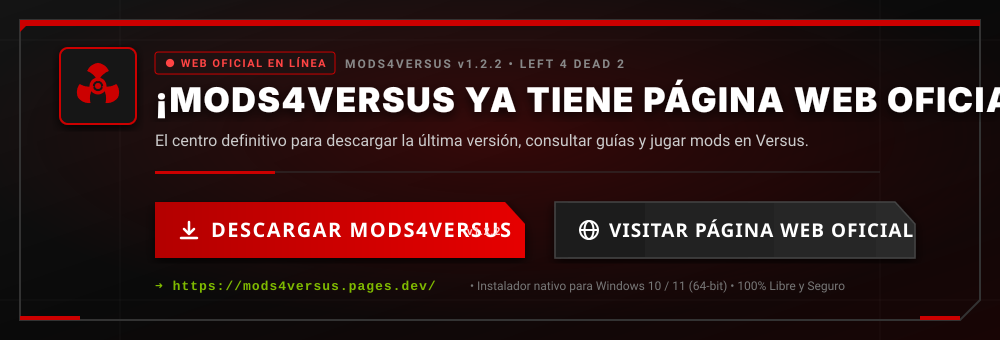
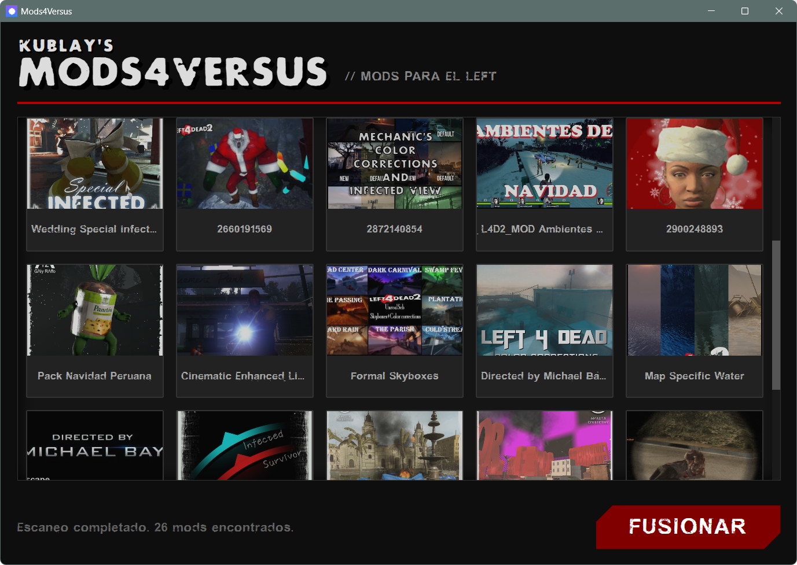
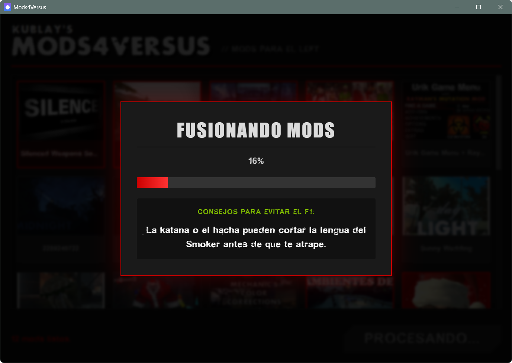
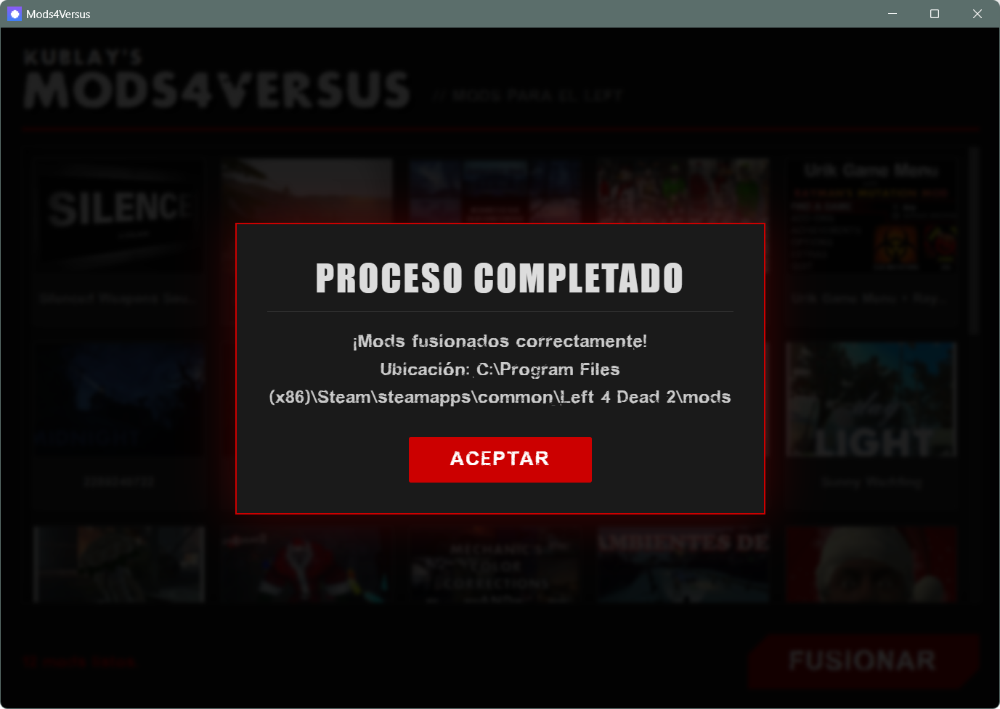

# 🧟 Mods4Versus — Gestor y Fusionador de Mods para Left 4 Dead 2

<!-- BANNER PRINCIPAL OFICIAL -->

  

<!-- BOTONES PRINCIPALES DE ACCIÓN -->

&nbsp;&nbsp;

  

<!-- BADGES DE ESPECIFICACIONES -->

-0078D6?style=flat-square&logo=windows&logoColor=white)

---

> [!IMPORTANT]
> ### 🚨 
> Si llegaste desde **TikTok**, YouTube o cualquier red social, **la descarga de la versión más reciente (v1.2.2), las guías oficiales y las futuras actualizaciones se encuentran centralizadas en nuestra nueva web**:
> 
> 👉 **[https://mods4versus.pages.dev/](https://mods4versus.pages.dev/)**
> 
> Utiliza los botones de arriba para acceder directamente a la descarga del instalador oficial para Windows.

---

## 🎮 ¿Qué es Mods4Versus?

En **Left 4 Dead 2**, cuando entras al modo **Versus**, los servidores activan de manera predeterminada la regla `sv_consistency 1`. Esta protección desactiva automáticamente todos los addons individuales instalados desde la Steam Workshop para evitar modificaciones que otorguen ventajas injustas.

**Mods4Versus** es una aplicación de escritorio nativa, moderna y ultraligera que soluciona este problema de raíz:

1. **Detecta automáticamente** tus suscripciones de Steam Workshop sin que tengas que buscar carpetas manualmente.
2. Te permite **seleccionar visualmente** qué mods deseas activar (supervivientes, infectados especiales, armas, sonidos o texturas).
3. **Fusiona los mods seleccionados** en un único paquete optimizado `pak01_dir.vpk` (formato Valve PAK versión 1) e inyecta la ruta de carga en `gameinfo.txt`.

El resultado: **juegas en cualquier servidor de Versus con tus mods favoritos activos**, sin conflictos de archivos, sin pantallas de error y sin tocar una sola línea de código.

---

## ✨ Características Principales

- 📦 **Fusión nativa de VPK:** Combina múltiples addons en un único paquete Valve PAK v1 para saltar las restricciones de consistencia del servidor.
- 🔄 **Detección automática de Steam:** Encuentra de forma autónoma tu instalación de *Left 4 Dead 2* y tus suscripciones de Workshop. Cero configuración de rutas.
- 🛡️ **100% Seguro — Sin riesgo de baneo (VAC):** No modifica archivos `.exe` ni librerías `.dll`, ni inyecta código en la memoria del juego. Solo gestiona archivos de contenido de forma estándar y segura.
- ↩️ **Restauración limpia en 1 clic:** ¿Quieres volver al juego original sin mods? Pulsa el botón **Restaurar** y tu juego volverá a su estado de fábrica en segundos, sin necesidad de verificar archivos en Steam.
- 🚀 **Ultraligero y rápido:** Desarrollado en **Rust** con **Tauri v2**. Ocupa apenas ~4.2 MB, no deja procesos pesados en segundo plano y fusiona decenas de mods en cuestión de segundos.
- 🖼️ **Gestión visual de mods:** Explora las miniaturas oficiales, títulos y detalles de tus mods antes de decidir cuáles incluir en tu partida.

---

## 📸 Capturas de Pantalla

  
    
  

    
    &nbsp;
    
  

---

## 📥 ¿Cómo descargarlo e instalarlo?

La distribución oficial de **Mods4Versus** se encuentra centralizada exclusivamente en su página web:

### 1. Descarga el instalador oficial
Entra a **[mods4versus.pages.dev](https://mods4versus.pages.dev/)** y haz clic en el botón **DESCARGAR AHORA** para obtener el instalador para Windows (`Mods4Versus_1.2.2_x64-setup.exe`).

### 2. Ejecuta la aplicación
Inicia el instalador y abre Mods4Versus. La aplicación detectará automáticamente tu juego y mostrará todos tus mods suscritos de la Workshop.

### 3. Selecciona y fusiona
Haz clic sobre los mods que quieras llevar a Versus y presiona el botón **FUSIONAR**. El proceso tardará solo unos segundos.

### 4. ¡A jugar!
Inicia *Left 4 Dead 2* desde Steam, entra a cualquier partida de Versus y juega con tus mods habilitados.

 

---

## ℹ️ Información Adicional

### 💻 Requisitos del Sistema
- **Sistema Operativo:** Windows 10 o Windows 11 (64-bit).
- **Juego:** *Left 4 Dead 2* instalado mediante Steam.
- **Espacio en disco:** Variable según la cantidad de mods que decidas fusionar (se recomienda al menos 2 GB libres).

### 📚 Documentación y Guías
En la web oficial dispones de artículos técnicos y soluciones a dudas frecuentes:
- 📖 [Cómo funciona el modo Versus y los mods](https://mods4versus.pages.dev/guias/como-funciona-modo-versus-mods.html)
- 📦 [Estructura de archivos VPK y pak01_dir.vpk](https://mods4versus.pages.dev/guias/estructura-archivos-vpk-l4d2.html)
- 🛠️ [Solución de conflictos, texturas púrpuras y cierres](https://mods4versus.pages.dev/guias/solucionar-conflictos-mods-l4d2.html)
- ❓ [Preguntas Frecuentes (FAQ)](https://mods4versus.pages.dev/faq/)

### ☕ Apoyo al Proyecto
Mods4Versus es un proyecto independiente y 100% gratuito. Si la herramienta te resulta útil y deseas apoyar su mantenimiento y desarrollo continuo, puedes colaborar mediante **Yape** desde la sección correspondiente en la web:
👉 **[Apoyar con Yape en la Web Oficial](https://mods4versus.pages.dev/#apoyo)**

### 📄 Licencia
Este proyecto es software libre publicado bajo los términos de la licencia **GNU General Public License v3.0 (GPLv3)**. Consulta el archivo [LICENSE.md](./LICENSE.md) para más detalles.

---

*Left 4 Dead 2 y Steam son marcas comerciales registradas de Valve Corporation.*  
*Mods4Versus es un proyecto independiente de la comunidad y no está afiliado, respaldado ni asociado con Valve Corporation.*

 

**[🌐 Visitar Sitio Web Oficial (mods4versus.pages.dev)](https://mods4versus.pages.dev/)**

